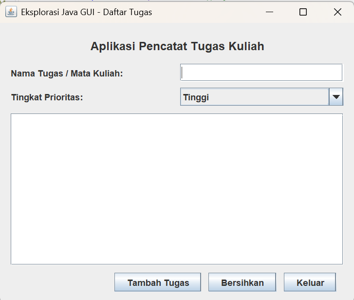
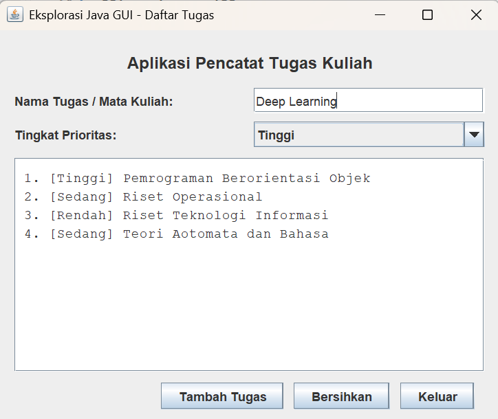
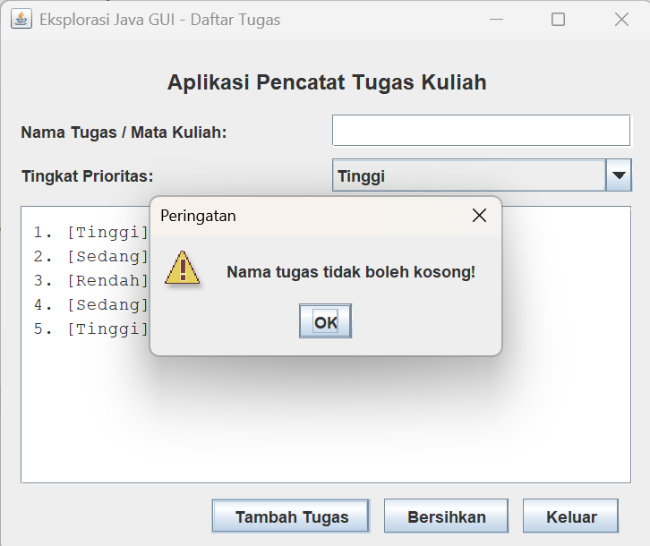

# Eksplorasi Komponen Java GUI (Swing)

Repositori ini berisi latihan implementasi komponen-komponen utama pada Java Swing untuk membangun aplikasi desktop sederhana: **Aplikasi Pencatat Tugas Kuliah**.

## Isi Repositori

```
.
├── EksplorasiGUI.java      # Kode sumber program
├── README.md               # Dokumentasi (file ini)
└── screenshots/
    ├── 01-tampilan-awal.png
    ├── 02-tugas-ditambahkan.png
    └── 03-peringatan-kosong.png
```

## Fitur Aplikasi

* Menambahkan tugas beserta tingkat prioritasnya (`Tinggi`, `Sedang`, `Rendah`) ke dalam daftar bernomor.
* Menambahkan tugas dengan klik tombol **Tambah Tugas** atau menekan **Enter** pada kolom input.
* Menampilkan peringatan (`JOptionPane`) jika nama tugas dikosongkan.
* Tombol **Bersihkan** mengosongkan daftar dan mereset penomoran.
* Tombol **Keluar** menutup aplikasi.

## 5 Komponen Utama GUI yang Digunakan

### 1. Top-Level Container Class
* **`JFrame`**: Jendela (*window*) utama aplikasi yang menampung seluruh elemen antarmuka, lengkap dengan *title bar* dan tombol kontrol jendela. Pada kode, `EksplorasiGUI` merupakan turunan (`extends`) dari `JFrame`.

### 2. Intermediate Container Class
* **`JPanel`**: Mengelompokkan komponen ke dalam sub-bagian terpisah (`panelUtama`, `panelHeader`, `panelTengah`, `panelForm`, dan `panelTombol`) agar tata letaknya mudah diatur.
* **`JScrollPane`**: Membungkus `JTextArea` sehingga daftar tugas dapat digulir (*scroll*) ketika isi teks melebihi ukuran area tampilan.

### 3. Atomic Component Class
Komponen dasar yang berinteraksi langsung dengan pengguna:
* **`JLabel`**: Teks statis untuk judul aplikasi dan keterangan pada form input.
* **`JTextField`**: Kolom input satu baris untuk mengetikkan nama tugas atau mata kuliah.
* **`JComboBox`**: Menu *dropdown* untuk memilih tingkat prioritas (`Tinggi`, `Sedang`, `Rendah`).
* **`JButton`**: Tombol aksi (`Tambah Tugas`, `Bersihkan`, `Keluar`).
* **`JTextArea`**: Area teks multi-baris (*read-only*) untuk menampilkan daftar tugas.

### 4. Layout Classes
Program ini menerapkan **3 Layout Manager** berbeda:

| Layout | Digunakan pada | Fungsi |
|---|---|---|
| `BorderLayout` | `panelUtama`, `panelTengah` | Membagi area menjadi `NORTH`, `CENTER`, dan `SOUTH` |
| `GridLayout(2, 2)` | `panelForm` | Menyusun label dan input dalam kisi 2 baris × 2 kolom |
| `FlowLayout` | `panelHeader`, `panelTombol` | Menyusun komponen sejajar secara horizontal |

### 5. Event Listener (Interface & Adapter Class)
* **`ActionListener` (Event Listener Interface)**: Diimplementasikan pada `btnTambah`, `btnHapus`, dan `btnKeluar` dengan meng-*override* `actionPerformed(ActionEvent e)` untuk merespons klik tombol.
* **`KeyAdapter` (Event Adapter Class)**: Diimplementasikan pada `txtNamaTugas` dengan meng-*override* `keyPressed(KeyEvent e)` agar tugas dapat ditambahkan dengan menekan tombol `Enter`.

### Komponen Pendukung
* **`JOptionPane`**: Dialog peringatan saat nama tugas kosong.
* **`EmptyBorder`**, **`Font`**, **`Insets`**: Pengaturan margin, jenis huruf, dan jarak isi komponen.

## Tangkapan Layar

**Tampilan awal**



**Setelah menambahkan beberapa tugas**



**Peringatan saat nama tugas kosong**



## Cara Menjalankan Program

1. Pastikan Java JDK sudah terpasang (cek dengan `java -version` dan `javac -version`).
2. Kompilasi file:
   ```bash
   javac EksplorasiGUI.java
   ```
3. Jalankan program:
   ```bash
   java EksplorasiGUI
   ```